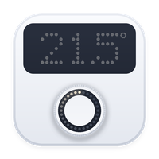
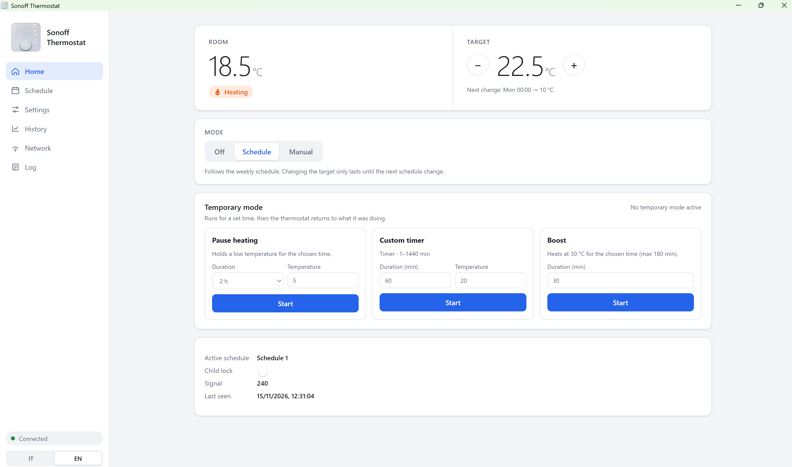
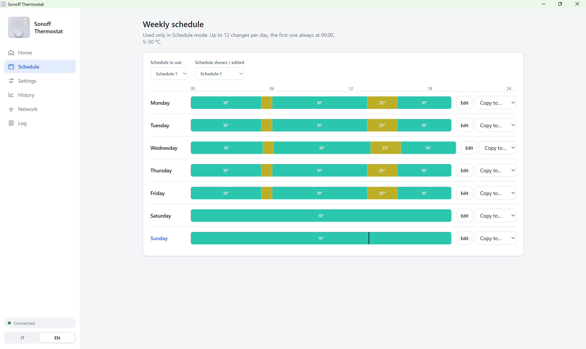
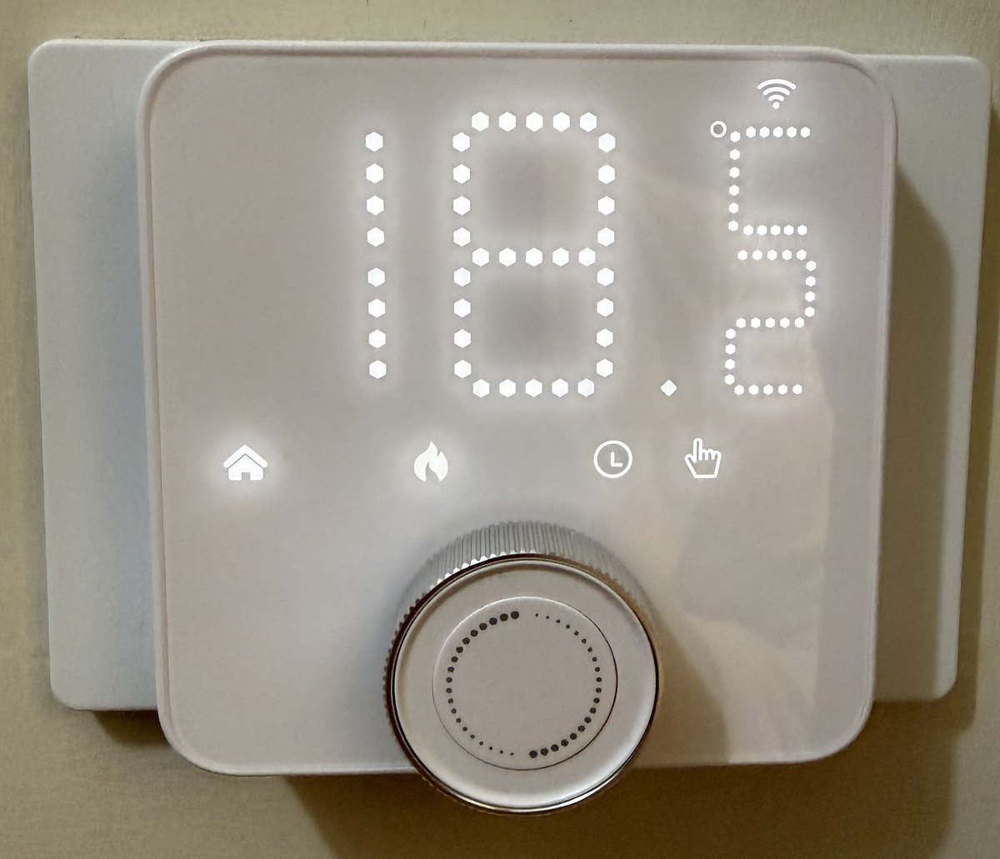

<p align="center">
  
</p>

<h1 align="center">Sonoff Thermostat</h1>

<p align="center">
  A Windows desktop app to control the <b>SONOFF TP-WGZBA</b> Zigbee thermostat (Thermostat Core) directly through a USB Zigbee dongle.<br>
  No Zigbee2MQTT, no MQTT broker, no Home Assistant, no cloud.
</p>

<p align="center">
  
  
</p>

> **Unofficial project.** It is not affiliated with, endorsed by or supported by SONOFF / ITEAD.
> "SONOFF" is a trademark of its owner and is used here only to say which device the app works with.

---

## Why this app exists

The TP-WGZBA is a Zigbee thermostat. To control it from a computer you normally need one of these:

- the **eWeLink** app plus a **SONOFF Zigbee hub**, which goes through the cloud;
- **Zigbee2MQTT** plus an **MQTT broker** plus a front end such as **Home Assistant**. That means three programs to install, configure and keep running, which is a lot for a single thermostat.

I only wanted to control **one thermostat from my PC** with a cheap USB Zigbee dongle. This app does that and nothing else. It is one program you install like any other Windows app. It talks to the dongle directly and gives you a simple interface for everything the thermostat can do.

Under the hood it uses the same libraries as Zigbee2MQTT ([zigbee-herdsman](https://github.com/Koenkk/zigbee-herdsman) and [zigbee-herdsman-converters](https://github.com/Koenkk/zigbee-herdsman-converters)), so device support is the same as in Zigbee2MQTT. The MQTT broker and the web front end are left out.

## Features

- **Home**: room temperature, target temperature (+/−), heating status, and the mode: *Off*, *Schedule* (weekly program) or *Manual*.
- **Temporary modes**: pause heating, custom timer or boost for a chosen time. Afterwards the thermostat goes back to what it was doing before.
- **Weekly schedule**: view and edit the three schedule groups stored on the thermostat, with up to 12 changes per day, and copy a day to other days.
- **Settings**: hysteresis, temperature calibration, frost protection, open window detection, child lock, external sensor, display brightness and night mode, presence radar, relay outputs, floor sensor (NTC) overheat protection.
- **History**: heating history recorded by the thermostat itself, by day, month or six months, as a chart and as a table.
- **Network**: choose the serial port and dongle type, pair the thermostat, list the devices.
- **Log**: live Zigbee log, useful for troubleshooting.
- **Languages**: English and Italian.
- Everything runs **locally**. No account, no internet connection needed.

## Requirements



| What | Details |
|---|---|
| Computer | Windows 10 or 11 (64-bit) |
| Thermostat | SONOFF **TP-WGZBA** (Thermostat Core) |
| Zigbee USB dongle | See the table below |

<br clear="right">

Supported dongle types (the *Adapter type* setting in the app):

| Adapter type | Chip | Example dongles |
|---|---|---|
| `ember` | Silicon Labs EFR32 (EmberZNet) | SONOFF ZBDongle-E, SONOFF Dongle Lite/Max MG24, Home Assistant Connect ZBT-1 |
| `zstack` | Texas Instruments CC2652 / CC1352 | SONOFF ZBDongle-P, SMLIGHT SLZB-06 |
| `deconz` | dresden elektronik | ConBee II / III, RaspBee II |
| `zigate` | ZiGate | ZiGate USB, USB-TTL, PiZiGate |
| `zboss` | Nordic nRF52840 (experimental) | nRF52840 dongles with ZBOSS firmware |

The app has been tested with an `ember` dongle (EmberZNet 7.4.4). The other types use the same code paths as Zigbee2MQTT but have not been tested with this app.

## Installation

1. Download **`Sonoff Thermostat Setup x.y.z.exe`** from the [Releases](../../releases) page.
2. Run it. The installer is not code-signed, so Windows SmartScreen may show *"Windows protected your PC"*. Click **More info → Run anyway**.
3. Choose the installation folder. A **Sonoff Thermostat** shortcut is created on the desktop.

To uninstall, use *Settings → Apps → Installed apps → Sonoff Thermostat*.

## First setup

1. **Plug in the dongle** and start the app.
2. Open the **Network** page.
3. Select the **serial port** of the dongle (for example `COM5`; press *Refresh* if it does not appear) and the **adapter type**, then press **Save & reconnect**.
4. Set up the Zigbee network. There are two options:
   - **You already use Zigbee2MQTT** with this thermostat: close Zigbee2MQTT, press **Import from Zigbee2MQTT…** and select its `data` folder (the one that contains `configuration.yaml`). The app copies the network keys and the device list, so **the thermostat keeps working without pairing it again**.
   - **Fresh start**: press **Create new network**. The app generates new random network keys.
5. **Pair the thermostat** (only needed for a new network):
   1. on the Network page press **Allow pairing (4 min)**;
   2. on the thermostat, in manual mode, turn the knob down to **"OF"** and hold the **middle button for 2 seconds**;
   3. after a few seconds the thermostat appears under *Devices* and the Home page shows its data.

The dongle can be used by **only one program at a time**. If Zigbee2MQTT (or any other Zigbee software) is running, close it first.

## How it works

```
 ┌────────────────────┐     USB / serial     ┌──────────────┐     Zigbee radio     ┌──────────────┐
 │  Sonoff Thermostat │ ───────────────────► │ Zigbee dongle│ ───────────────────► │  TP-WGZBA    │
 │  (Electron app)    │ ◄─────────────────── │ (coordinator)│ ◄─────────────────── │  thermostat  │
 └────────────────────┘                      └──────────────┘                      └──────────────┘
```

- The dongle is the **coordinator** of a small private Zigbee network, and the thermostat is the only device in it.
- **zigbee-herdsman** drives the dongle and manages the network. **zigbee-herdsman-converters** translates the thermostat's Zigbee messages into readable values (temperature, mode, schedule…) and back.
- The app is built with **Electron**. The main process runs the Zigbee stack, and the window shows the interface.

### Where the data is stored

Everything is stored in `%APPDATA%\Sonoff Thermostat\zigbee\`:

| File | Content |
|---|---|
| `config.json` | serial port, adapter type, language and the **network keys** |
| `database.db` | paired devices |
| `coordinator_backup.json` | backup of the dongle's network settings |
| `state.json` | last known values of the thermostat |
| `app.log` | log file |

`config.json` and `coordinator_backup.json` contain your **network key**, so do not share them. Back up this folder if you reinstall Windows: with it you will not need to pair the thermostat again.

### Good to know

- The thermostat **keeps working on its own** (schedule, manual mode, frost protection) when the app or the PC is off. You just can't control it remotely during that time.
- When the coordinator is unreachable for a long time (app closed or dongle unplugged), the thermostat periodically wakes its display and tries to reconnect. This is how the thermostat's firmware works and the app cannot change it. To avoid it, keep the app running with the dongle plugged in.
- Changing the target temperature in *Schedule* mode only lasts until the next change in the schedule. Use *Manual* mode or a temporary mode to keep a temperature for longer.

## Building from source

You need [Node.js](https://nodejs.org/) 22 LTS or newer and Git.

```bash
git clone https://github.com/<your-user>/<repository>.git
cd <repository>
npm install
npm start          # run the app in development mode
npm run dist       # build the Windows installer into the dist/ folder
```

Project structure:

```
src/
├── main/
│   ├── main.js      # Electron main process: window, IPC, app lifecycle
│   ├── zigbee.js    # Zigbee service (zigbee-herdsman + converters)
│   ├── config.js    # configuration, network keys, Zigbee2MQTT import
│   └── preload.js   # safe bridge between the window and the main process
└── renderer/
    ├── index.html   # user interface
    ├── app.js       # pages and logic of the interface
    ├── i18n.js      # English / Italian translations
    └── styles.css
```

## Troubleshooting

| Problem | What to do |
|---|---|
| Status *Error* with `HOST_FATAL_ERROR` or the port does not open | The dongle is unplugged, or another program (Zigbee2MQTT…) is using it. Close the other program, re-plug the dongle and press *Connect*. |
| The serial port is not in the list | Press *Refresh*. Check in *Device Manager → Ports (COM & LPT)* that Windows sees the dongle; some dongles need the CP210x or CH340 USB driver. |
| Wrong adapter type | Check the chip of your dongle in the table above, choose the right type and press *Save & reconnect*. |
| The thermostat does not pair | Make sure *Allow pairing* is active (the countdown is running) and repeat the pairing gesture on the thermostat. Move the dongle away from the PC with a USB extension cable to reduce interference. |
| Something else | Open the **Log** page, or `app.log` in the data folder, and include it when you open an issue. |

## License

This project is released under the **MIT License**. See [LICENSE](LICENSE).

You can use, copy, modify and redistribute it, including for commercial purposes, as long as you keep the copyright notice. It comes **without any warranty**: you use it at your own risk.

### Third-party software

The app is built on these open-source projects, all under the MIT License:

- [Electron](https://github.com/electron/electron)
- [zigbee-herdsman](https://github.com/Koenkk/zigbee-herdsman) and [zigbee-herdsman-converters](https://github.com/Koenkk/zigbee-herdsman-converters) by Koen Kanters and contributors. They are the heart of Zigbee2MQTT. Many thanks to them.
- [js-yaml](https://github.com/nodeca/js-yaml), [serialport](https://github.com/serialport/node-serialport)

The installer also includes Chromium and Node.js (through Electron). Their licenses are included in the installed app (`LICENSE.electron.txt`, `LICENSES.chromium.html`).
